# DeepResearch Agent

## Demo

[](media/research_demo.mp4)

A full research run on the test case *"Is the Great Wall of China visible from space with the naked eye?"*, sped up about 12 times: from pressing **Start research**, through the six phases with the live agent log, to the finished report and its PDF. The real run took 3 minutes 35 seconds.

**[▶ Open the full-quality video (media/research_demo.mp4, 37 seconds)](media/research_demo.mp4)**

---

### An agentic AI that researches a topic on the web, cross-validates every fact against trusted sources, and writes a cited PDF report

**Project documentation · AI course · B.Tech Computer Science**

---

## Contents

0. [Demo](#demo)
1. [Abstract](#1-abstract)
2. [Introduction](#2-introduction)
3. [Background concepts](#3-background-concepts)
4. [System overview](#4-system-overview)
5. [System design (diagrams)](#5-system-design-diagrams)
6. [Data schemas](#6-data-schemas)
7. [Algorithms](#7-algorithms)
8. [Implementation](#8-implementation)
9. [Web user interface](#9-web-user-interface)
10. [Testing](#10-testing)
11. [Results: research test cases](#11-results-research-test-cases)
12. [Limitations](#12-limitations)
13. [Future work](#13-future-work)
14. [Conclusion](#14-conclusion)
15. [How to run the project](#15-how-to-run-the-project)
16. [References](#16-references)

---

## 1. Abstract

Large language models (LLMs) can answer questions fluently, but a single LLM answer has no sources, cannot be checked, and may contain made-up facts (hallucinations). This project builds **DeepResearch Agent**, an *agentic* AI system that does research in several steps, the way a careful student would:
1. It plans research questions.
2. It searches the web, news, Wikipedia and scholarly papers.
3. It reads the most useful sources and pulls out single facts with supporting quotes.
4. It **cross-validates** every fact against independent, trusted websites.
5. It writes a detailed PDF report in which every sentence is cited.

The agent loop is written from scratch in Python, with no LangChain or other agent framework. The LLM is Google Gemini on the free tier: `gemini-3.5-flash-lite`, `gemini-3.1-flash-lite` and `gemini-embedding-2`.

Each fact receives a **confidence label**: Verified, Likely, Contested or Unverified. The label depends on how many independent websites support it and how trustworthy those websites are. The system has a Streamlit web interface with a neo-brutalism design, live progress, resumable runs, and an in-page PDF viewer.

On three test topics (a clinical question, a popular myth, and a fast-moving technology), the agent produced 8–9 page cited reports in about 3½ to 6 minutes. It also detected real disagreements between sources and flagged them as Contested.

---

## 2. Introduction

### 2.1 Problem statement

When a student or analyst researches a topic online, they must:
- find relevant sources among thousands of search results;
- judge which sources are trustworthy;
- check whether different sources agree;
- write a summary with proper citations.

Doing this by hand is slow. A plain chatbot is fast, but its answers are not grounded in sources and cannot be verified. The problem is to build a system that is **fast like an AI assistant but verifiable like a manual literature review**.

### 2.2 Objectives

1. Build an **agentic AI** in which the LLM decides its own actions (which searches to run, which pages to open, when to stop) through function calling.
2. Collect sources from several search services and give every source a **trust tier**.
3. Extract single-fact **claims** with quotes, and reject any claim whose quote is not really in the source.
4. **Cross-validate** claims across independent websites and give each a **confidence label**.
5. Produce a detailed **PDF report** in which every sentence cites its sources, and disagreements are shown openly.
6. Provide a **web user interface** with live progress, earlier runs, and resume after interruptions.
7. Run entirely on the **free tier** of the Gemini API.

### 2.3 Scope

- **Input:** any research topic in English, and a depth (quick, standard or deep).
- **Sources:** public web pages and PDFs found through DuckDuckGo, Wikipedia and OpenAlex. Pages behind paywalls or logins are skipped.
- **Output:** a PDF report, a JSON record of the whole run (`state.json`) and an event log (`trace.jsonl`).
- **Out of scope:** private databases, non-English sources, images and videos as evidence, and proving that a fact is true. The confidence label is an *estimate* of support, not a proof.

---

## 3. Background concepts

| Concept | Simple explanation | Where it is used |
|---|---|---|
| **LLM (Large Language Model)** | A neural network trained on large amounts of text that can read and write natural language. Gemini is Google's LLM family. | Every agent role |
| **Agentic AI** | An AI system that chooses its own next actions (tool calls) to reach a goal, instead of giving one fixed answer. | Researcher, Verifier |
| **ReAct (Reason + Act)** | A loop in which the LLM reasons about what to do, calls a tool, reads the result (observation), and repeats ([Yao et al., 2023](#16-references)). | `researcher.py` |
| **Function calling** | The LLM replies with a structured request such as `web_search(query="…")` instead of text. Our code runs the function and sends the result back. | `gemini.py`, `researcher.py` |
| **Structured output** | The LLM is forced to reply with JSON that matches a schema, so the program can read the answer reliably. | Planner, Extractor, Verifier, Writer |
| **Embedding** | A list of numbers (a vector) that represents the meaning of a sentence. Sentences with similar meaning have similar vectors. | `verifier.py` |
| **Cosine similarity** | A measure of how close two vectors point; 1.0 means the same direction (same meaning). | `verifier.py` |
| **Source credibility (trust tier)** | A score for how trustworthy a type of website is (government and journals high, forums low). It is a proxy, not proof. | `credibility.py` |
| **Groundedness check** | A check that a claim really comes from its source, here by finding its quote in the source text. | `extractor.py` |
| **Prompt injection** | Text on a web page that tries to give the LLM instructions. Tool results are marked as untrusted data to reduce this risk. | `gemini.py`, all prompts |

---

## 4. System overview

One research run goes through **six phases**. Phases 2 and 4 are agent loops: Gemini decides the next action, our code carries it out, and the result goes back to Gemini.

| # | Phase | Agent role | What happens | Output |
|---|---|---|---|---|
| 1 | Plan | Planner | Splits the topic into 4–8 research questions, each with 2–3 search queries | Questions |
| 2 | Research (loop) | Researcher | ReAct loop with 7 tools: searches, opens the best results, scores each website, stops when every question has enough good sources | Sources with trust tiers |
| 3 | Extract | Extractor | Pulls up to 6 single-fact claims from each source; keeps a claim only if its quote is found in the source | Claims |
| 4 | Cross-validate (loop) | Verifier | Groups matching claims (embeddings), asks Gemini which sources agree or disagree, counts independent websites, gives labels, searches again for weak claims | Labelled claim groups |
| 5 | Write | Writer + Critic | Writes one section per question and a summary from Verified/Likely claims; the rule-based critic removes uncited sentences | Report text |
| 6 | Publish | PDF builder | Builds the PDF with a table of contents, charts and references, and copies it to the main folder | `report.pdf` |

The state of the run is saved after every phase, so a run stopped by an error or by the daily free quota can be **resumed** from the first unfinished phase.

### Confidence labels

| Label | Rule |
|---|---|
| **Verified** | 2 or more independent websites agree, at least one is tier 1 or 2, and no tier 1 or 2 source disagrees |
| **Likely** | Supported by one tier 1 source, or by 2 or more independent websites |
| **Contested** | A tier 1 or 2 source disagrees, so the report shows both sides |
| **Unverified** | Only one low-trust source. A targeted search is tried; if support stays weak, the claim is left out of the findings |

---

## 5. System design (diagrams)

All diagrams are written as code and drawn with standard tools:
- **PlantUML** 1.2026.1 for the UML diagrams;
- **Graphviz** (`dot`) 16.1.0 for the architecture and data flow diagrams.

The source files are in [`diagrams/`](diagrams). Data flow diagrams use **Gane–Sarson notation**: rounded boxes for processes, shaded boxes for external entities, and open-ended boxes for data stores.

### 5.1 System architecture

The layered structure of the system: entry points (web page, command line, evaluation), the pipeline, the five agent roles, the tools, report output, external services and files on disk.

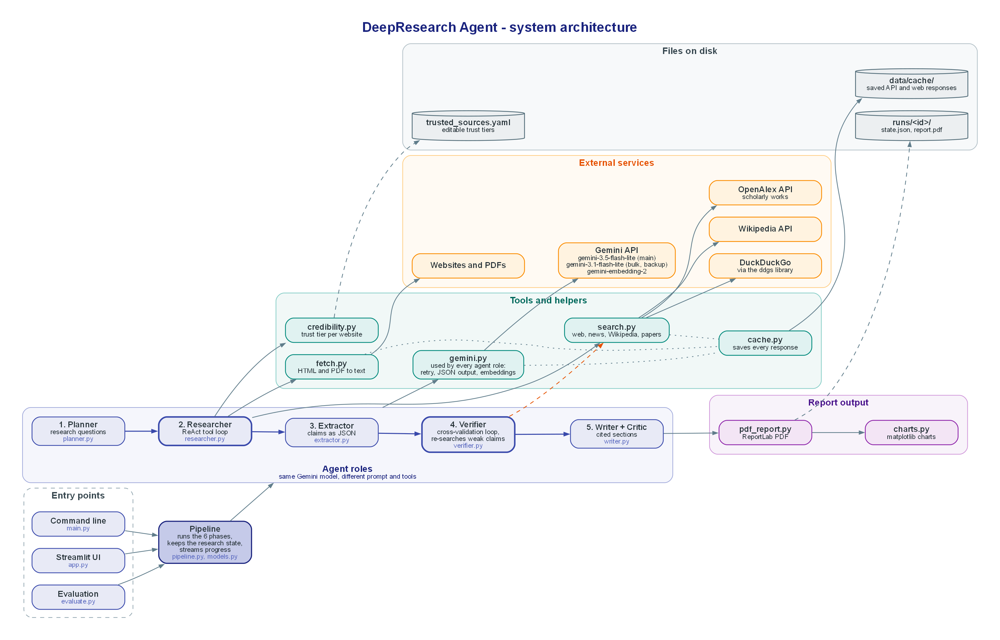

### 5.2 Deployment diagram

What runs where. The browser, Python process and project files are on the student's laptop. Gemini, the search services and the websites are reached over HTTPS.

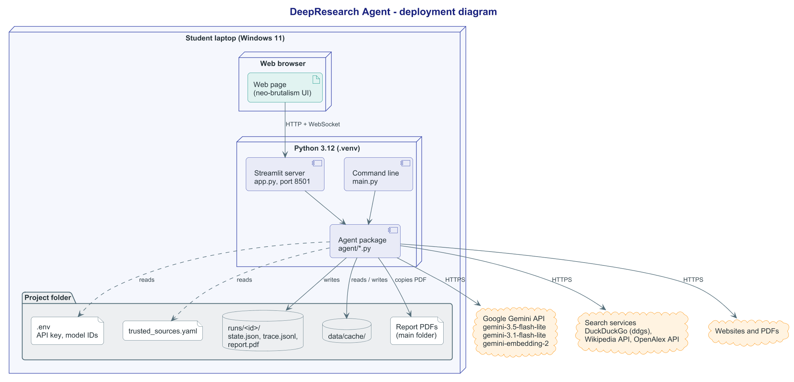

### 5.3 Data flow diagram – level 0 (context diagram)

The whole system as one process, with its four external entities and the data exchanged with each.

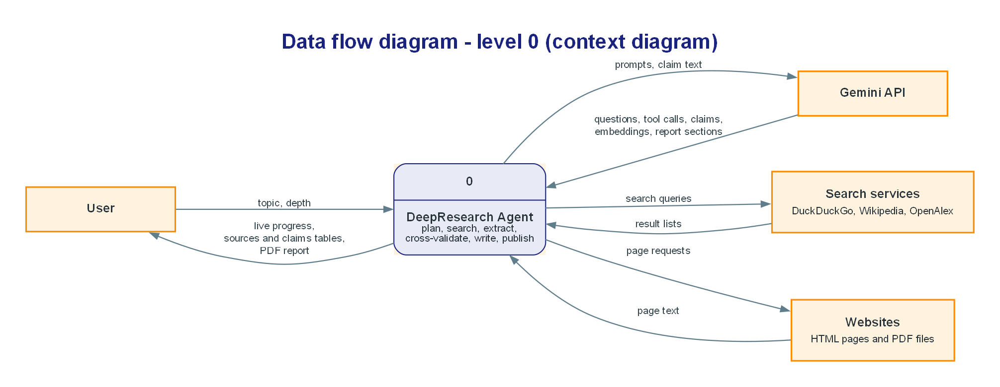

### 5.4 Data flow diagram – level 1

The six processes (1.0–6.0), the three data stores (research state, trust list, response cache), and every data flow between them.

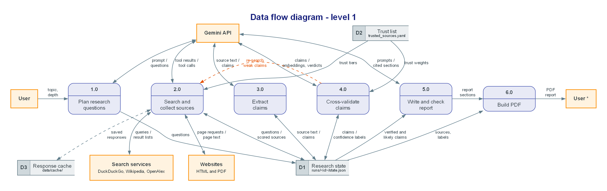

### 5.5 Use case diagram

What the user can do with the system, and which external systems take part.

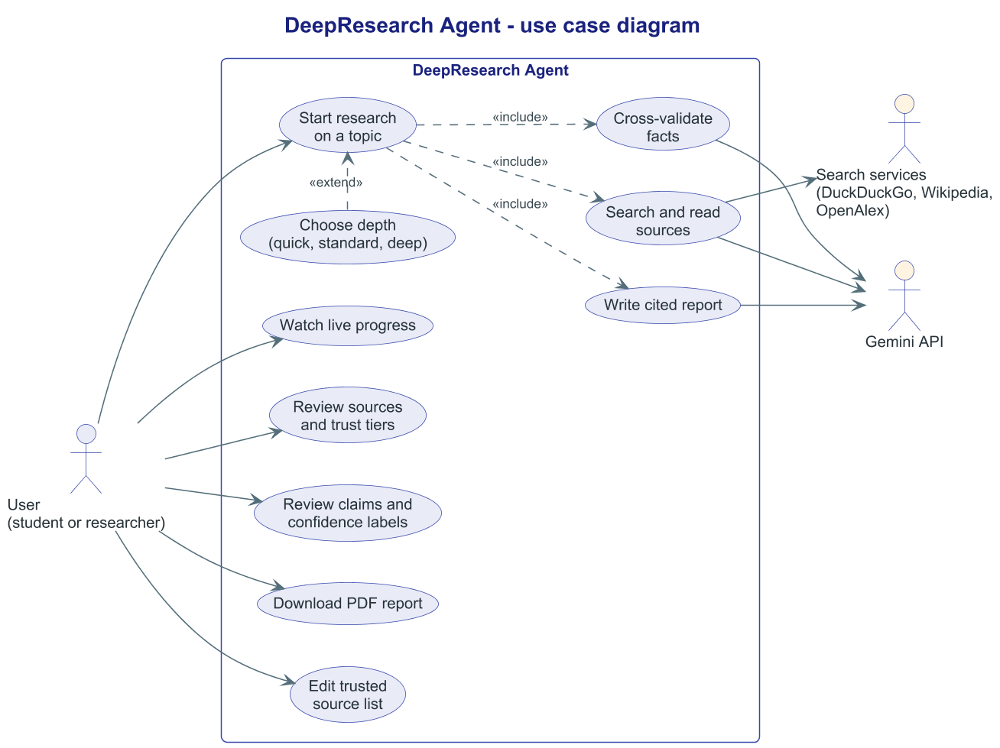

### 5.6 Sequence diagram – one research run

The order of messages between the user, the web page, the pipeline, the agent roles, the tools, Gemini and the files, phase by phase.

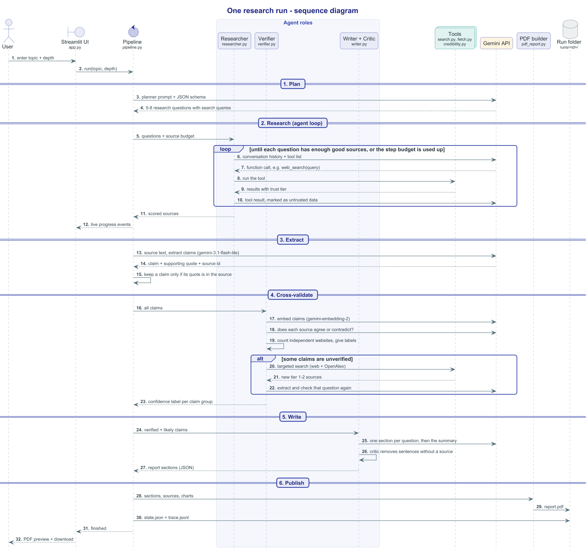

### 5.7 Activity diagram – Researcher agent loop (ReAct)

How the Researcher decides, calls up to four tools in parallel, sends results back, and when it stops. It also shows the reminder and the finish guard that keep a lighter model on track.

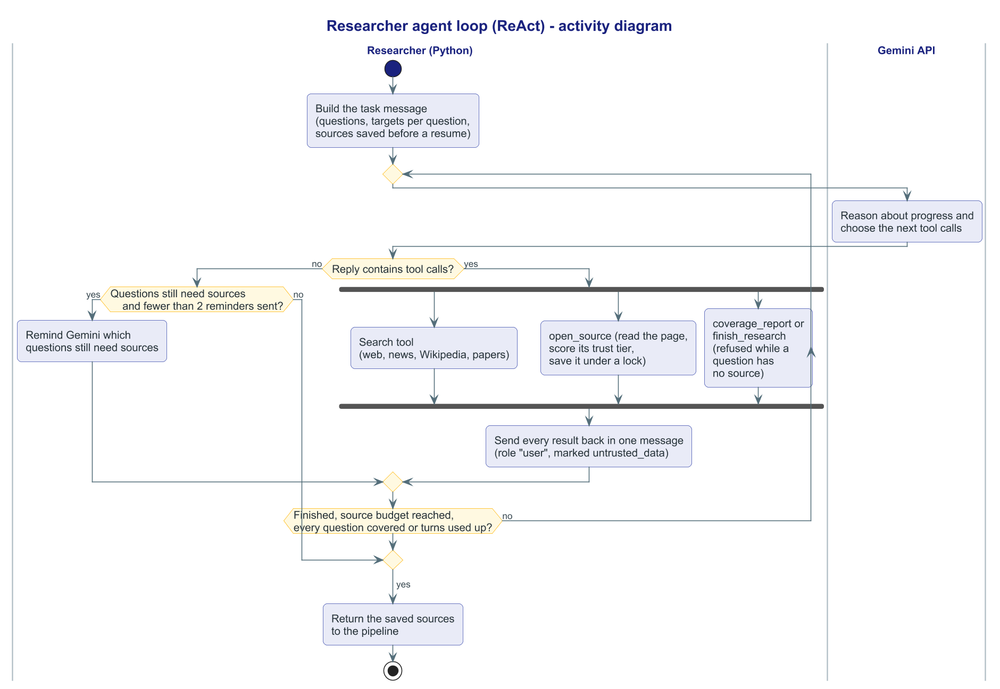

### 5.8 Activity diagram – cross-validation

How claims are grouped, checked for agreement, counted by independent websites and labelled, followed by the targeted re-search for Unverified claims.

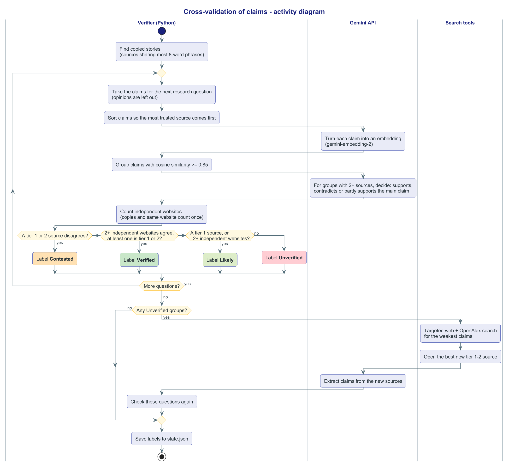

### 5.9 State machine diagram – research run

A run moves through the six phases inside the **Running** state. On an error or a used-up quota it moves to **Stopped**. **Resume** returns to the last active phase (UML history state `H`).

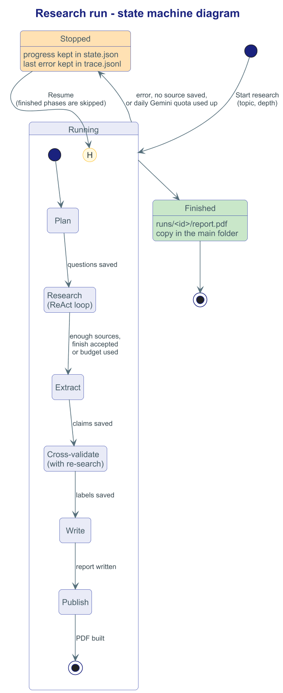

### 5.10 Class diagram – research data model

The Pydantic classes in `agent/models.py` that hold everything a run produces.

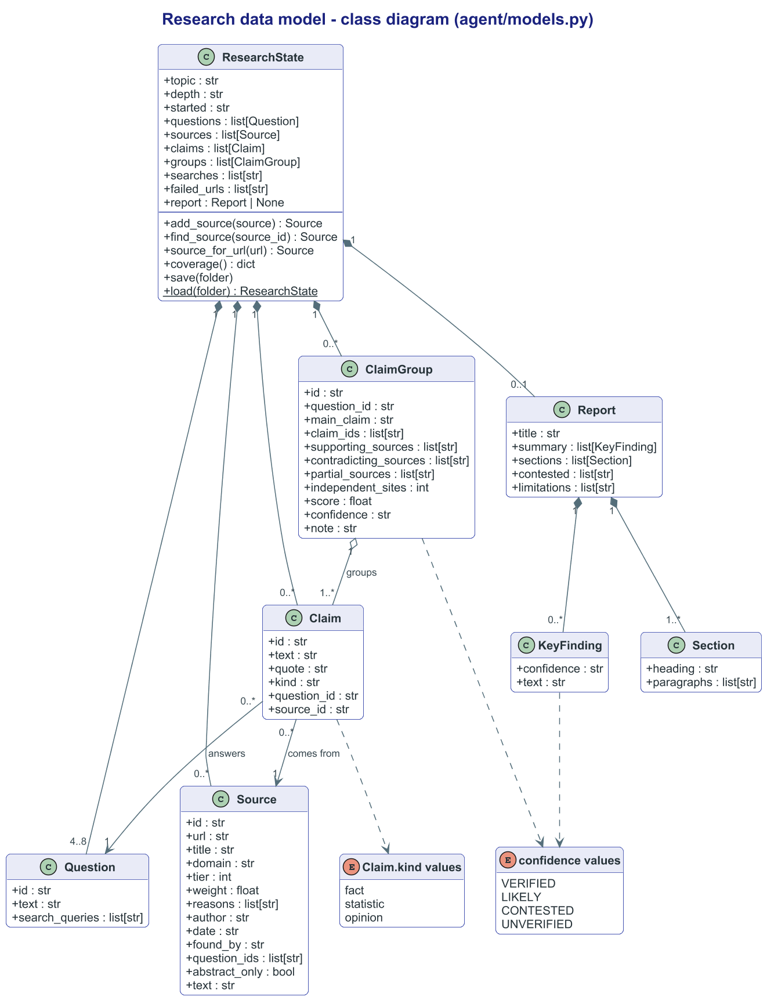

### 5.11 Entity relationship diagram – data schema

The logical schema of the research data, in crow's-foot notation. The data is stored as nested JSON in `state.json`, not in a database. The link entities (QUESTION_SOURCE, GROUP_MEMBER, GROUP_SOURCE) correspond to the ID lists inside the JSON.

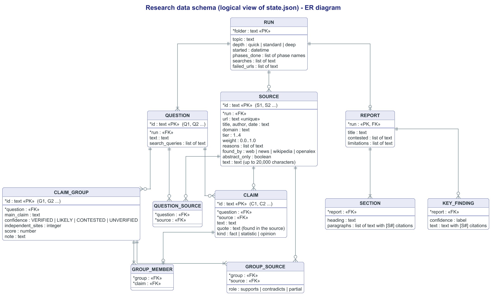

---

## 6. Data schemas

### 6.1 Run record – `runs/<id>/state.json`

One JSON file per run, written by `ResearchState.save()` after every phase.

| Field | Type | Meaning |
|---|---|---|
| `topic`, `depth`, `started` | text | What was asked, the depth preset, and the start time |
| `questions[]` | `{id, text, search_queries[]}` | Research questions from the Planner |
| `sources[]` | `{id, url, title, domain, tier, weight, reasons[], author, date, found_by, question_ids[], abstract_only, text}` | Every source the Researcher saved |
| `claims[]` | `{id, text, quote, kind, question_id, source_id}` | Single-fact claims; `kind` is `fact`, `statistic` or `opinion` |
| `groups[]` | `{id, question_id, main_claim, claim_ids[], supporting_sources[], contradicting_sources[], partial_sources[], independent_sites, score, confidence, note}` | Claim groups with their confidence label |
| `searches[]`, `failed_urls[]` | text lists | Every search that was run, and pages that could not be opened |
| `extracted_sources[]`, `phases_done[]` | text lists | Progress markers that make **resume** possible |
| `report` | `{title, summary[{confidence, text}], sections[{heading, paragraphs[]}], contested[], limitations[]}` | Report text; citations are written as `[S3]` |

### 6.2 Event log – `runs/<id>/trace.jsonl`

One JSON object per line, written for every agent action. The web page shows these events live.

```json
{"time": "20:40:14", "phase": "Research", "kind": "tool", "text": "step 4: open_source(url=https://pib.gov.in/..., question_id=Q2)"}
```

`kind` is one of `phase`, `tool`, `source`, `info`, `warning`, `error` or `done`.

### 6.3 Trust list – `agent/trusted_sources.yaml`

```yaml
tiers:
  1: {label: Official or academic, weight: 0.9, suffixes: [gov, edu, ac.in, gov.in, ...], domains: [who.int, nature.com, rbi.org.in, ...]}
  2: {label: Reputable media and reference, weight: 0.7, suffixes: [], domains: [reuters.com, bbc.com, wikipedia.org, ...]}
  3: {label: General website, weight: 0.4, suffixes: [], domains: []}
  4: {label: Forum, social media or user content, weight: 0.1, suffixes: [], domains: [reddit.com, quora.com, ...]}
overrides:
  wikipedia.org: {weight: 0.6, reason: "encyclopedia anyone can edit, used to find primary sources"}
  arxiv.org: {weight: 0.75, reason: "preprint server, papers are not yet peer reviewed"}
```

### 6.4 Gemini structured-output schemas

Every JSON answer from Gemini is checked against a Pydantic class. The JSON Schema is generated with `model_json_schema()` and passed as `response_json_schema`.

| Agent role | Schema (example reply) |
|---|---|
| Planner – `Plan` | `{"questions": [{"question": "…", "search_queries": ["…", "…"]}]}` |
| Extractor – `Extraction` | `{"claims": [{"claim": "…", "quote": "exact words from the source", "kind": "statistic", "question_id": "Q2"}]}` |
| Verifier – `CheckResult` | `{"groups": [{"group_id": "g1", "verdicts": [{"claim_id": "C12", "verdict": "contradicts"}], "note": "…"}]}` |
| Writer – `SectionText` | `{"paragraphs": ["Sentence with a citation [S3][S7]."]}` |
| Writer – `SummaryText` | `{"title": "…", "key_findings": [{"group_id": "G1", "sentence": "… [S1]."}]}` |

### 6.5 Tool (function) declarations given to the Researcher

| Tool | Parameters | Returns |
|---|---|---|
| `web_search` | `query` | Up to 8 results: title, link, snippet, website, trust tier |
| `news_search` | `query` | News results with date and publisher |
| `wikipedia_search` | `topic` | Wikipedia page summaries |
| `paper_search` | `query` | OpenAlex scholarly works: title, link, journal, year, abstract |
| `open_source` | `url`, `question_id` | Saves the page as a source; returns its ID, tier, weight and the first 1,000 characters |
| `coverage_report` | (none) | Sources and good sources per question, and the remaining budget |
| `finish_research` | `reason` | Accepted only when every question has at least one source |

### 6.6 Configuration – `.env`

| Key | Default | Meaning |
|---|---|---|
| `GEMINI_API_KEY` | (required) | Key from Google AI Studio |
| `MAIN_MODEL` | `gemini-3.5-flash-lite` | Planning, agent loop, verifying, writing |
| `LITE_MODEL` | `gemini-3.1-flash-lite` | Bulk claim extraction |
| `BACKUP_MODEL` | `gemini-3.1-flash-lite` | Used when the main model is busy, slow or out of daily quota |
| `EMBED_MODEL` | `gemini-embedding-2` | Claim embeddings |
| `GEMINI_TIMEOUT` | `60` | Seconds before a Gemini call counts as failed |
| `DEPTH` | `standard` | Default depth: quick (4 questions, 10 sources), standard (6, 20) or deep (8, 35) |

---

## 7. Algorithms

### 7.1 Researcher agent loop (ReAct with function calling)

```text
history = [task message: topic, questions, targets]
for turn in 1 .. max_steps:
    reply = Gemini(history, tools)                      # reason
    if reply has no tool calls:
        if questions still need sources and reminders < 2: add a reminder and continue
        else: stop
    results = run the tool calls in parallel (max 4)    # act
    history += [reply, results marked as untrusted]     # observe
    stop if finish_research was accepted, the source budget is used,
         or every question has enough sources (at standard depth: 3 sources, 2 of them tier 1 or 2)
```

### 7.2 Trust score of a source

```text
tier = 1 if the website's suffix or domain is in tier 1, 2 if in tier 2, 4 if in tier 4, otherwise 3
if found in OpenAlex: a journal article or review is tier 1, a preprint is tier 2
weight = tier weight (or the override for Wikipedia / arXiv)
weight += 0.05 if an author is named, + 0.05 if a date is given
forums and social media never go above 0.2
```

### 7.3 Cross-validation

```text
for each research question:
    claims = non-opinion claims, sorted by source weight (most trusted first)
    vectors = embed(claims)                              # gemini-embedding-2
    groups = leader grouping: a claim joins the first group whose first claim has cosine >= 0.85
    for groups with 2+ sources: Gemini labels each claim supports / contradicts / partial
    independent sites = distinct websites, where copies (sources sharing most 8-word phrases) count once
    label = Contested   if a tier 1-2 source contradicts
            Verified    if 2+ independent sites support and one is tier 1-2
            Likely      if a tier 1 source or 2+ independent sites support
            Unverified  otherwise
for the weakest Unverified groups: targeted web + OpenAlex search, open the best new tier 1-2 page,
extract its claims and check that question again
```

### 7.4 Rule-based critic

```text
for each sentence the Writer produced:
    remove citations to sources that do not support the finding
    keep the sentence only if at least one valid citation is left
```

### 7.5 Model fallback and quota handling

```text
for model in [requested model, backup, lite]:
    skip the model if it is still blocked (busy in the last 5 minutes, or daily quota used up)
    try the call; on "too many requests per minute" wait 2, 4, 8 ... seconds and retry
    on overload (503), timeout (60 s) or daily quota: block the model and try the next one
if every model is out of quota: stop the run with the time the quota resets; the run can be resumed later
```

---

## 8. Implementation

### 8.1 Modules

| File | Responsibility |
|---|---|
| `agent/config.py` | Settings, exact model IDs, depth presets |
| `agent/gemini.py` | All Gemini calls: retry, model fallback, daily-quota handling, JSON output, embeddings, tool messages |
| `agent/cache.py` | Saves every API and web response in `data/cache/`, so repeated work costs nothing |
| `agent/models.py` | Pydantic data model of a run (`ResearchState` and its parts) |
| `agent/pipeline.py` | Runs the six phases, writes `trace.jsonl`, saves progress, resumes stopped runs, copies the PDF to the main folder |
| `agent/planner.py` | Phase 1: research questions |
| `agent/researcher.py` | Phase 2: ReAct tool loop, parallel tools, finish guard, abstract fallback |
| `agent/extractor.py` | Phase 3: claims with the quote (groundedness) check |
| `agent/verifier.py` | Phase 4: embeddings, grouping, agreement check, copy detection, labels, targeted re-search |
| `agent/writer.py` | Phase 5: sections, summary, contested points, limitations, rule-based critic |
| `agent/pdf_report.py` | Phase 6: ReportLab PDF with table of contents, clickable citations and appendix |
| `agent/charts.py` | matplotlib charts for the PDF (colour-blind-checked palette) |
| `agent/search.py` | DuckDuckGo (via `ddgs`), Wikipedia and OpenAlex search |
| `agent/fetch.py` | Reads web pages (`trafilatura`) and PDFs (`pypdf`) politely: timeouts, size limit, 1 request per second per website |
| `agent/credibility.py`, `agent/trusted_sources.yaml` | Trust tier and weight of every website |
| `app.py`, `style.css`, `.streamlit/config.toml` | Streamlit web page with the neo-brutalism design |
| `main.py` | Command line (`python main.py "topic" --depth quick`, `--resume <folder>`) |
| `run_app.bat` | One-click launcher for Windows |

### 8.2 Technology used

| Name | Version | Used for |
|---|---|---|
| Python | 3.12 | Programming language |
| `google-genai` (Google Gen AI SDK) | 2.29.0 | Gemini API: text, JSON output, function calling, embeddings |
| `ddgs` | 9.16.0 | DuckDuckGo web and news search (an unofficial library, not an official DuckDuckGo API) |
| `requests` | 2.34.2 | Wikipedia API (MediaWiki Action API and Wikimedia REST API), OpenAlex API, page downloads |
| `trafilatura` | 2.3.1 | Main text, title, author and date from HTML pages |
| `pypdf` | 6.20.0 | Text from PDF sources |
| `tldextract` | 5.4.0 | The real domain of a link (for example `bbc.co.uk`) |
| `pydantic` | 2.14.0 | Data model and JSON schemas |
| `numpy` | 2.5.3 | Cosine similarity |
| `PyYAML` | 6.0.3 | Trust list |
| `ReportLab` | 5.0.1 | PDF report |
| `matplotlib` | 3.11.2 | Charts in the PDF |
| `Streamlit` with `streamlit-pdf` | 1.65.0 / 2.1.0 | Web page and in-page PDF viewer (`altair` and `pandas` for charts and tables) |
| `pytest` | 9.1.1 | Unit tests |
| PlantUML, Graphviz | 1.2026.1, 16.1.0 | Diagrams |

### 8.3 Choice of Gemini models

**What it is:** the project uses three Gemini models through the Gemini API:
- `gemini-3.5-flash-lite` (main);
- `gemini-3.1-flash-lite` (bulk extraction and backup);
- `gemini-embedding-2` (embeddings).

**Why we use it:** the free tier has a small **daily request limit per model**. During development, Google's own error message reported only **20 requests per day** for `gemini-3.6-flash`, and `gemini-3.8-flash` was often overloaded (HTTP 503, or 60–120 seconds per answer). Third-party guides report about 500 requests per day for each Flash-Lite model, and the official numbers for an account are shown in Google AI Studio. In our tests both Flash-Lite models supported parallel function calling and JSON output and answered in 3–4 seconds.

**How it works in our project:**
- **Separate quotas:** the main and bulk roles use two different models, so their daily quotas add up.
- **Fallback:** if one model is busy or out of quota, the next model in the chain is used automatically (algorithm 7.5).

**Result:** a standard run needs about 30 main-model calls plus one bulk call per source, so several full runs fit in one day on the free tier.

### 8.4 Safety and good behaviour

- **Prompt injection:**
  - Tool results are wrapped as `untrusted_data`.
  - Every prompt tells Gemini never to follow instructions found inside sources.
  - Answers must match a fixed JSON schema.
- **Polite crawling:**
  - A clear User-Agent and a 20-second timeout.
  - An 8 MB size limit.
  - One request per second per website, also across parallel tool calls.
  - Only `http`/`https` links; paywalls and login pages are skipped.
- **Hallucination control:**
  - Quotes must be found in the source.
  - Findings come only from cross-validated claims.
  - The critic removes uncited sentences.
- **Copyright:** the report summarises in its own words and only quotes short evidence, always with a citation.

---

## 9. Web user interface

The web page (`app.py`) uses a **neo-brutalism** design:
- thick black outlines and hard offset shadows;
- flat bright colours (yellow, pink, cyan, lime) on a cream dotted background;
- Space Grotesk and Archivo Black fonts.

Buttons press down when clicked. The design is defined in `style.css` and `.streamlit/config.toml`.

**Start a run:** type a topic or click one of the three example topics, choose the depth, and press **Start research**.

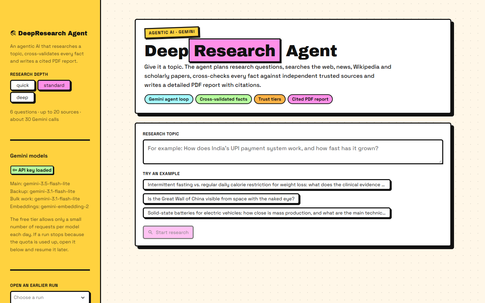

**Live progress:** a phase stepper, four live counters (questions, sources, claims, verified groups), and a live log of the newest agent actions: tool calls, saved sources with their tiers, warnings and labels.

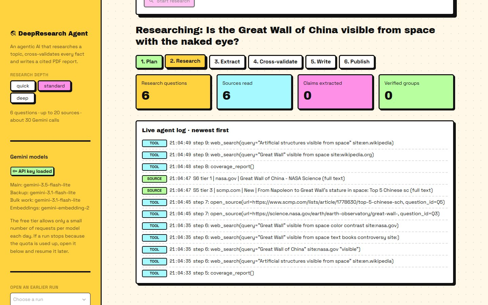

**Results:** report title, label counts, a Download PDF button, and seven tabs:
- **Summary:** key findings with confidence badges.
- **Findings:** every `[n]` citation links to the original source.
- **Contested points**, **Sources** (charts and source table), **Claims**, **Method** (with the full agent trace), and **PDF report** (viewed in the page).

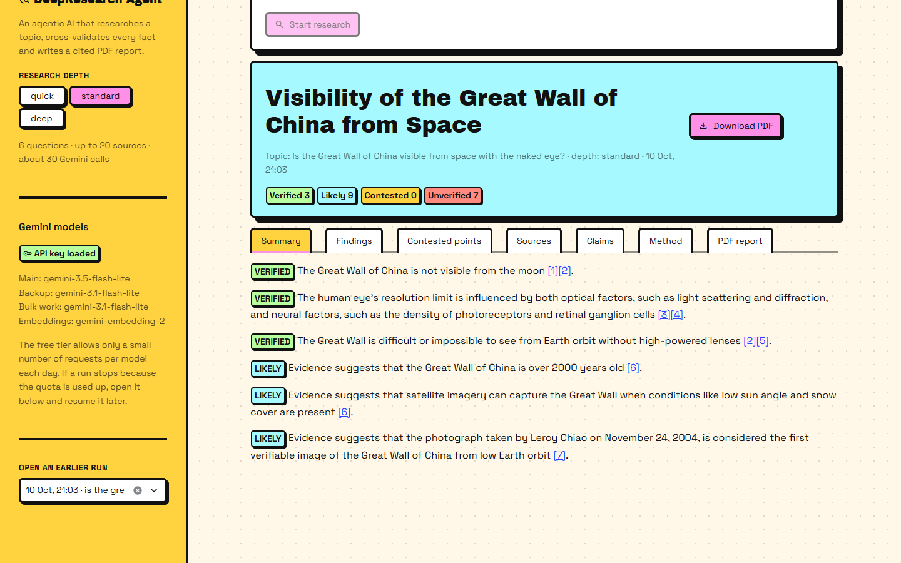

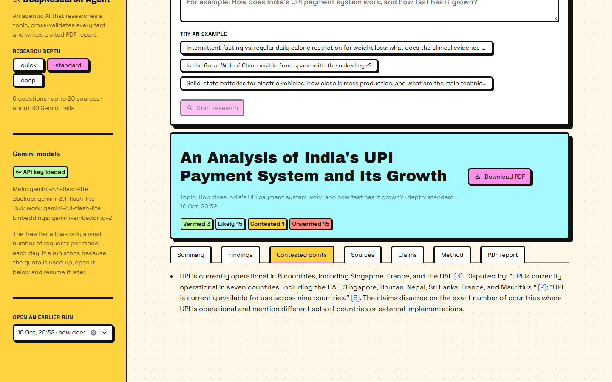

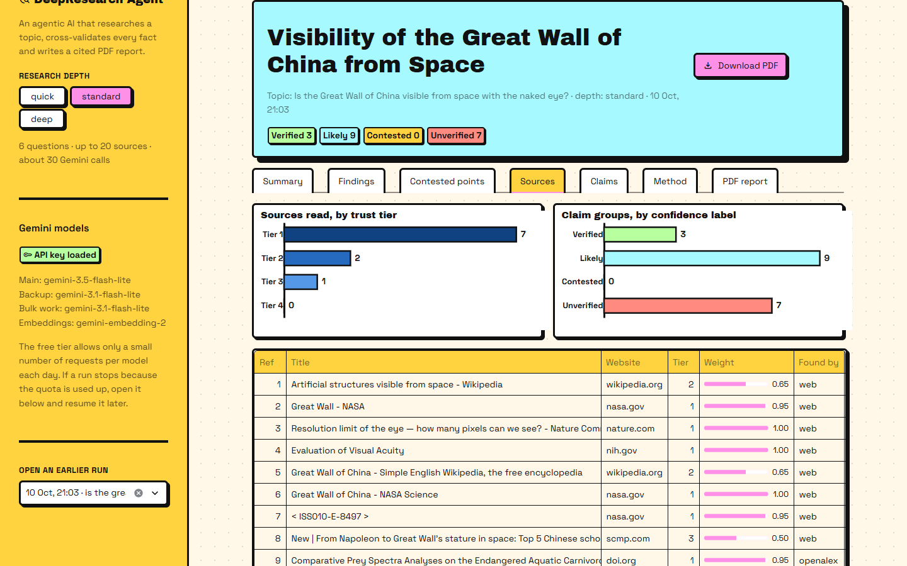

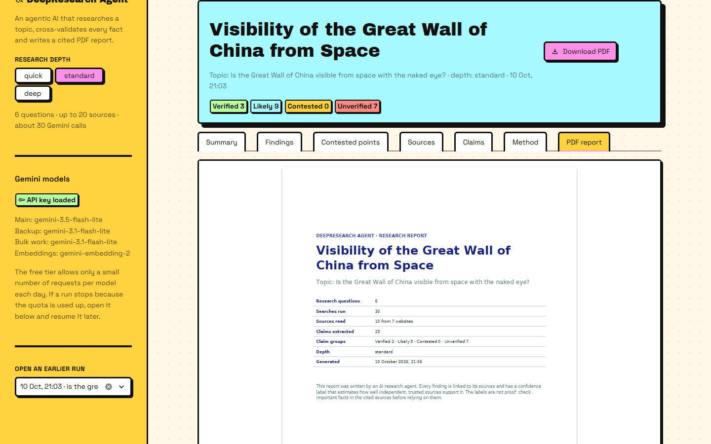

**Earlier runs and resume:** the sidebar lists every earlier run. A stopped run shows why it stopped and has a **Resume** button.

The full sped-up demo of the web page is at the [top of this document](#demo).

---

## 10. Testing

### 10.1 Unit tests

There are **73 unit tests** written with `pytest`, kept in a local `tests/` folder that is not part of this repository. They use fake Gemini replies and fake web pages, so they run in about 2 seconds with no internet connection and no API key.

| Area | Tests | What is checked |
|---|---|---|
| Gemini wrapper | 16 | Retries, model fallback, daily-quota handling, clear error when every model is used up, JSON output, one embedding per text, tool messages |
| Trust tiers | 11 | Government, university and Indian regulator domains, news subdomains, forums capped at 0.2, Wikipedia/arXiv overrides, OpenAlex work types |
| Verifier | 8 | Claim grouping, copy detection, every label rule, Gemini verdicts |
| Page reading | 7 | Allowed link types, HTML and PDF text, caching, paywall and size limits |
| Search | 7 | Result format, empty results not cached, abstract rebuilding, retracted papers skipped |
| Researcher | 6 | Tool loop, parallel tool calls with unique IDs, finish guard, per-website limit, abstract fallback, step budget |
| Writer | 6 | Critic, citation lists, reference numbering, contested points |
| Pipeline | 5 | Phase order, files written, resume skips finished phases, PDF copy in the main folder |
| Extractor | 3 | Quote (groundedness) check |
| Data model | 3 | Duplicate sources, coverage, save and load |
| PDF | 1 | All sections, citations and symbols present |

Result: **73 passed**.

### 10.2 Live testing and fixes

The whole system was also run end to end against the real Gemini API and live websites, from both the command line and the web page. Live testing found these problems, which were then fixed and covered by unit tests:

| Problem found in live testing | Fix |
|---|---|
| The Gemini API rejected tool results sent with role `tool` | Tool results are sent with role `user` |
| `gemini-embedding-2` returned one vector for a list of texts | Each text is sent as its own content item |
| `gemini-3.8-flash` was overloaded (503, or 60–120 s answers) | Backup model, 60 s timeout, and a 5-minute skip of a busy model |
| Free-tier daily limit of 20 requests on `gemini-3.6-flash` | Switched to Flash-Lite models, detected the daily quota, added resume |
| DuckDuckGo sometimes returned nothing for a moment | One retry, and empty results are never cached |
| OpenAlex DOI links hid the real website (e.g. a WHO report) | The publisher's landing page is used for scoring |
| Publishers such as ScienceDirect block downloads (HTTP 403) | The OpenAlex abstract is used and marked "abstract only" |
| The lighter model once finished research without opening any source | Finish guard plus reminders in every search reply |
| Searches took about 8 s each and ran one after another | Tool calls of one turn run in parallel (4 at a time) |
| Indian official sources (RBI, NPCI) were scored as ordinary websites | Added to tier 1, with major Indian news sites in tier 2 |

---

## 11. Results: research test cases

Three test topics were chosen to test different abilities of the agent:
- a **clinical** question that needs scholarly sources;
- a popular **myth** that cross-validation must not confirm;
- a **fast-moving technology** topic with company claims and changing timelines.

All three were run at **standard** depth (6 questions, up to 20 sources) on 10 October 2026 with `gemini-3.5-flash-lite`.

### 11.1 Summary table

| # | Test case | What it tests | Time | Sources (tier 1 / 2 / 3) | Claims | Verified / Likely / Contested / Unverified | PDF pages | Report (PDF, main folder) |
|---|---|---|---|---|---|---|---|---|
| 1 | Intermittent fasting vs. daily calorie restriction | Clinical evidence, scholarly sources | 3 min 24 s | 12 (12 / 0 / 0) | 54 | 5 / 19 / 1 / 0 | 9 | [Intermittent fasting … (2026-10-10 2057).pdf](<Intermittent fasting vs. regular daily calorie restriction for weight loss what does the clinical evidence say (2026-10-10 2057).pdf>) |
| 2 | Is the Great Wall of China visible from space? | Myth detection | 3 min 35 s | 10 (7 / 2 / 1) | 25 | 3 / 9 / 0 / 7 | 8 | [Is the Great Wall … (2026-10-10 2106).pdf](<Is the Great Wall of China visible from space with the naked eye (2026-10-10 2106).pdf>) |
| 3 | Solid-state batteries for electric vehicles | Fast-moving technology, blocked publishers | 6 min 15 s | 9 (7 / 2 / 0) | 39 | 2 / 10 / 0 / 6 | 8 | [Solid-state batteries … (2026-10-10 2045).pdf](<Solid-state batteries for electric vehicles how close is mass production, and what are the main technical challenges (2026-10-10 2045).pdf>) |

Each PDF is also stored with its full research record (`state.json`, `trace.jsonl`) in its run folder under `runs/`.

### 11.2 Test case 1 – Intermittent fasting vs. daily calorie restriction

*"Intermittent fasting vs. regular daily calorie restriction for weight loss: what does the clinical evidence say?"*

- **Sources:** all 12 are tier 1. They come from journals and health agencies: BMJ, The Lancet, Nature, Frontiers, Springer and NIH.
- **Verified finding:** with matched energy deficits, long-term studies showed **no difference in weight loss** between intermittent fasting and daily calorie restriction.
- **Contested point:** one 12-month trial found that 4:3 intermittent fasting gave greater weight loss. Another source reported that only alternate-day fasting showed a benefit. The report shows both studies, each with its citation.

### 11.3 Test case 2 – Is the Great Wall of China visible from space?

*"Is the Great Wall of China visible from space with the naked eye?"* This is the run shown in the [demo](#demo).

- **Sources:** 10 in total, 7 of them tier 1, including three NASA pages, Nature and NIH. The Researcher used 13 turns, and the Verifier's targeted searches added 3 more sources.
- **Result:** the popular claim was **not** confirmed. The Verified findings say the opposite:
  - *"The Great Wall of China is not visible from the moon."*
  - *"The Great Wall is difficult or impossible to see from Earth orbit without high-powered lenses."*
  - The limits of human visual resolution (optical and neural factors) explain why.
- **Likely findings:** satellite imagery can capture the wall under a low sun angle or with snow cover, and a photograph taken by astronaut Leroy Chiao on 24 November 2004 is described as the first verifiable image from low Earth orbit. Each comes from a single source, so they are labelled Likely.
- **Left out:** 7 claims found in only one lower-trust source were labelled Unverified and kept out of the findings. One source added by a targeted search turned out to be off-topic, and no claims were extracted from it.

### 11.4 Test case 3 – Solid-state batteries for electric vehicles

*"Solid-state batteries for electric vehicles: how close is mass production, and what are the main technical challenges?"*

- **Sources:** 9 in total, 7 tier 1 and 2 tier 2. Many publisher pages blocked automated downloads: 18 pages could not be opened, and 5 sources were read from their OpenAlex abstracts instead.
- **Verified findings:**
  - Solid electrolytes replace flammable liquid electrolytes, which reduces the risk of thermal runaway.
  - Lithium dendrite formation is a major hurdle to commercial production.
- **Likely findings:** costs of about \$800–\$1,500 per kWh, and a 75–83% loss of cycle life when moving from coin cells to large pouch cells. Both come from a single tier 1 review, so they are labelled Likely, not Verified.

### 11.5 Additional runs

| Topic | Depth | Sources (tier 1 / 2 / 3) | Claims | Verified / Likely / Contested / Unverified | PDF |
|---|---|---|---|---|---|
| Microplastics in drinking water: health effects | quick | 8 (8 / 0 / 0) | 32 | 4 / 10 / 0 / 0 | [PDF](<Microplastics in drinking water health effects (2026-10-10 2030).pdf>) |
| How does India's UPI payment system work, and how fast has it grown? | standard | 15 (9 / 4 / 2) | 65 | 3 / 15 / 1 / 15 | [PDF](<How does India's UPI payment system work, and how fast has it grown (2026-10-10 2045).pdf>) |

In the UPI run the cross-validation found that sources disagree on **how many countries UPI works in** (7, 8 or 9). The report flags this as Contested and shows all three claims with their citations, instead of picking one number.

---

## 12. Limitations

- **Labels are estimates:** trust tiers describe the type of website, not the accuracy of one page. The confidence label measures support, not truth.
- **Free-tier quotas:** limits are per model and per day and can change. When every model is used up, a run stops and must be resumed later.
- **Lighter model:** Flash-Lite is fast and has a high limit, but its reasoning is weaker than the Flash models. Guardrails (the finish guard and reminders) were needed.
- **Blocked or paywalled publishers:** some sources are only available as abstracts.
- **Search quality and speed:** `ddgs` is an unofficial library. Each search takes about 8 s and sometimes returns nothing for a short time.
- **Embedding similarity and negation:** sentences that differ only by "not" can be very similar as vectors. This is why Gemini checks every group for agreement or contradiction.
- **Automatic metadata:** the author and date are read automatically from each page and are sometimes wrong.
- **English only**, and no images or videos as evidence.

---

## 13. Future work

- **Automatic evaluation** (`evaluate.py`): compare the agent with a plain one-call Gemini answer on key-fact coverage, citation precision and myth detection.
- **Source date awareness:** prefer recent sources for fast-moving topics.
- **More scholarly sources:** add open-access full texts (for example Europe PMC or arXiv full text) for papers that are blocked today.
- **Human feedback:** let the user correct a label or block a website from the web page.

---

## 14. Conclusion

The project shows that a small, hand-written agent can make LLM research **verifiable**:
- The ReAct loop with function calling lets Gemini plan and gather its own sources.
- Trust tiers, the quote check and cross-validation keep the report tied to evidence.
- The rule-based critic ensures every sentence is cited.

The live test cases showed the system finding trustworthy sources, labelling well-supported facts as Verified, and openly reporting disagreements between sources. It runs on free-tier models and recovers from quota limits with resume.

---

## 15. How to run the project

You need Python 3.12 and a free Gemini API key from [Google AI Studio](https://aistudio.google.com).

1. Copy `.env.example` to `.env` and paste your key after `GEMINI_API_KEY=`.
2. Double-click **`run_app.bat`**. It:
   - creates `.venv` and installs `requirements.txt` the first time;
   - starts the web page;
   - opens http://localhost:8501.

Command line instead of the web page:

```bash
python main.py "Is the Great Wall of China visible from space with the naked eye?" --depth standard
```

Resume a stopped run:

```bash
python main.py --resume runs/20261010-210312_is-the-great-wall-of-china-visible-from-
```

Regenerate the diagrams (from the `diagrams` folder, with Graphviz installed and the PlantUML jar downloaded):

```bash
java -jar C:/Users/020ar/tools/plantuml/plantuml.jar -charset UTF-8 -tpng -Sdpi=150 *.puml
```

```bash
for f in architecture dfd_level_0 dfd_level_1; do dot -Tpng -Gdpi=150 $f.dot -o $f.png; done
```

---

## 16. References

1. Yao, S., Zhao, J., Yu, D., Du, N., Shafran, I., Narasimhan, K., & Cao, Y. (2023). *ReAct: Synergizing Reasoning and Acting in Language Models.* International Conference on Learning Representations (ICLR). arXiv:2210.03629.
2. Google. *Gemini API documentation*: models, function calling, structured output, embeddings, rate limits. https://ai.google.dev/gemini-api/docs
3. Priem, J., Piwowar, H., & Orr, R. (2022). *OpenAlex: A fully-open index of scholarly works, authors, venues, institutions, and concepts.* arXiv:2205.01833. API: https://docs.openalex.org
4. Barbaresi, A. (2021). *Trafilatura: A Web Scraping Library and Command-Line Tool for Text Discovery and Extraction.* Proceedings of ACL-IJCNLP 2021: System Demonstrations.
5. Gane, C., & Sarson, T. (1979). *Structured Systems Analysis: Tools and Techniques.* Prentice Hall (data flow diagram notation).
6. Wikimedia Foundation. *MediaWiki Action API* and *Wikimedia REST API* documentation. https://www.mediawiki.org/wiki/API:Main_page
7. Streamlit documentation. https://docs.streamlit.io
8. ReportLab documentation. https://docs.reportlab.com
9. PlantUML. https://plantuml.com · Graphviz. https://graphviz.org
